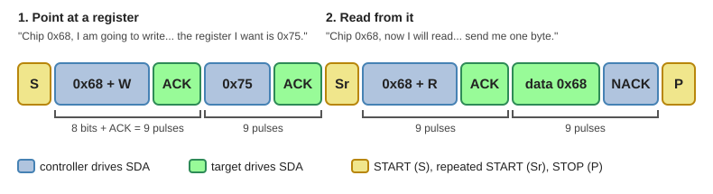

# Appendix A: The I2C Bus

By the end of this appendix you'll be able to:

- Explain how a CPU uses just two wires to talk to many chips and picks one chip by its address
- Turn the raw bytes from a sensor into a real number with Python
- Describe how the CPU takes turns with five devices, and why a slow display can delay the sensors

A robot is full of small chips: one feels motion, one finds north, one measures
distance, one watches the battery, one drives a screen. Every one of them needs
to talk to the main CPU, and a CPU only has so many pins. This appendix explains
the clever trick that lets one CPU talk to dozens of chips using just two wires.

!!! mascot-welcome "Welcome to the I2C Bus!"
    { class="mascot-admonition-img" }
    Today we peek inside a real robot and watch its chips talk to each other,
    one polite turn at a time. You'll scan a bus, read raw bytes, and see why a
    screen can slow down a sensor. Let's code it together!

## I2C in One Minute

Here is the whole idea at a glance. Every term in this table gets its own
explanation below.

| Question | Answer |
|----------|--------|
| What is it? | A two-wire bus that connects a CPU to many small chips |
| What are the wires? | SCL (the clock) and SDA (the data) |
| Who is in charge? | One controller (your CPU). It starts every conversation |
| How does it pick a chip? | Every chip has a 7-bit address. The controller says the address first |
| How does a chip say "yes"? | It pulls SDA low for one clock pulse: an ACK |
| Can two chips talk at once? | No. One conversation at a time, so the CPU takes turns |
| How fast? | 100,000 or 400,000 bits per second on most boards |

You say it "eye-squared-see" or "eye-two-see". It stands for *Inter-Integrated
Circuit*, and Philips (now NXP) invented it in the early 1980s.

## 1. What Is a Bus?

Picture a classroom where the teacher asks questions. Every student hears every
question, but each question starts with a name: "Maya, what is 7 times 8?" Only
Maya answers. Everyone else stays quiet and keeps listening for their own name.

A **bus** works the same way. It is a set of shared wires that many chips are
connected to. Every chip hears everything the controller sends, but each message
starts with an address, and only the chip that owns that address responds.

Why use a shared bus instead of giving every chip its own wires? Count the pins.

| Connection | Signal wires | Chips on the same wires | Typical use |
|------------|--------------|-------------------------|-------------|
| I2C | 2 (SDA, SCL) | up to about 112 | sensors, small displays, clocks |
| SPI | 3 plus 1 per chip | a few (one extra pin each) | fast displays, SD cards |
| UART | 2 per chip pair | exactly 2 | GPS, serial consoles |

With I2C you can add a sixth, seventh or tenth chip and the CPU still uses the
same two pins. That is why robots, phones and laptops are full of it.

## 2. Meet the Hardware

The robot in this appendix uses the parts below. The table lists each chip, what
it does, and the address it answers to. The five-device MicroSim near the end
uses everything except the compass.

| Device | Chip (breakout board) | What it does | I2C address |
|--------|-----------------------|--------------|-------------|
| Accelerometer | MPU-6050 (GY-521) | feels pushes and gravity | `0x68` |
| Gyroscope | MPU-6050 (same chip) | feels how fast the robot turns | `0x68` |
| Compass | HMC5883L (GY-271) | senses Earth's magnetic field | `0x1E` |
| Distance sensor | VL53L0X | times a pulse of light to an obstacle | `0x29` |
| Battery monitor | INA219 | measures battery voltage and current | `0x40` |
| Display | SSD1306 128x64 OLED | shows text and pictures | `0x3C` |

Notice that the accelerometer and the gyroscope are one chip with one
address. They are two sensors, but only one device on the bus. Leave out the
compass and the other five functions need just four addresses: `0x68`, `0x29`,
`0x40` and `0x3C`. Add the compass back and you have five addresses for six
functions.

!!! warning "Parts notes: read these before you buy"
    - **Compass clones.** Many modules sold as "GY-271 / HMC5883L" today carry a
      different chip, the QMC5883L, which answers at `0x0D` instead of `0x1E`.
      Some carry a QMC5883P at `0x2C`. An I2C scan tells you in seconds which one
      you have, and the code for each chip is different.
    - **Combo boards.** On boards that put an MPU-6050 and an HMC5883L together
      (GY-86 and GY-87), the compass is wired to the MPU-6050's own private
      bus. To see it from your CPU, you must switch on the MPU-6050's *bypass
      mode* (`I2C_BYPASS_EN`, bit 1 of register `0x37`).
    - **Age.** The MPU-6050 and HMC5883L are older parts. They are cheap and
      well documented, which makes them great for learning, but check
      availability before designing a product around them.

### Wiring the Bus

Every device connects to the same four lines. Nothing about the wiring changes
as you add devices, except that you add one more set of wires to the same
holes.

| Wire | Raspberry Pi Pico pin | Goes to every device's... |
|------|-----------------------|---------------------------|
| SDA (data) | GP0 (physical pin 1) | SDA |
| SCL (clock) | GP1 (physical pin 2) | SCL |
| Power | 3V3(OUT) (physical pin 36) | VCC (3.3 volts) |
| Ground | GND (for example, pin 38) | GND |

On the Pico, `I2C(0, sda=Pin(0), scl=Pin(1))` is the I2C bus these pins belong
to. Other pin pairs work too: I2C0 can use GP0/GP1, GP4/GP5 and others, and I2C1
can use GP2/GP3, GP6/GP7 and others.

!!! tip "Safety first"
    The INA219 sits between the battery and the robot, so it handles real power.
    Ask an adult to help you wire anything that connects to a LiPo battery, and
    never let the bare battery wires touch each other.

## 3. Two Wires: SDA and SCL

I2C uses exactly two signal wires.

- **SCL** is the *clock*. The controller ticks it like a metronome. One tick
  moves the conversation along by one bit.
- **SDA** is the *data*. It carries the bits, one per tick, in both
  directions. Only one chip talks at a time, so the data wire is shared.

The data rule is simple. The sender may change SDA only while SCL is low. The
receiver reads SDA while SCL is high. So the bits stay still exactly when
someone is looking at them.

### Pull-up Resistors: Why a Wire Only Goes One Way

Here is the surprising part. No chip on an I2C bus is ever allowed to push a
wire *high*. A chip can only pull a wire *down* to ground, or let go.

Imagine a spring holding a rope up. A chip can pull the rope down, and when it
lets go the spring pulls it back up. The spring is a **pull-up resistor**, a
small resistor (about 4,700 ohms is typical) connected from each wire to the
positive power line. When nobody pulls, the resistor keeps the wire high. When
any chip pulls, the wire goes low.

This design solves two problems at once:

1. **No short circuits.** If two chips push in opposite directions, a push-high
   chip fighting a pull-low chip would cause a short. Pull-down-only means the
   worst case is a polite tie.
2. **ACK works.** During the ACK clock pulse the controller lets go of SDA. If a
   chip pulls it low, the controller sees a 0. If nobody does, the resistor
   keeps it high and the controller sees a 1.

The breakout boards usually carry their own pull-up resistors, so the bus often
works with no extra parts. The Pico's built-in pull-ups are weak, so rely on the
ones on the boards.

### START, STOP and Speed

Two special moments mark the edges of a conversation. Both happen while SCL is
high, which is normally forbidden for SDA to change:

- **START:** SDA falls while SCL is high. "I am about to talk."
- **STOP:** SDA rises while SCL is high. "I am finished. The bus is free."

Most boards run the bus at 100,000 bits per second (**standard mode**) or
400,000 bits per second (**fast mode**). MicroPython's `I2C` class uses 400,000
unless you pass a different `freq`.

!!! info "Controller and target"
    Older books call the CPU the "master" and the chips "slaves". Since Revision
    7.0 (2021), the official I2C specification from NXP says **controller** and
    **target** instead, and the MicroPython documentation says *controller* and
    *peripheral*. This appendix uses controller and target.

## 4. Anatomy of a Transaction

Every conversation, called a **transaction**, follows the same script:

1. The controller sends START.
2. The controller sends the **address**: 7 bits, followed by one **R/W bit**
   (0 means "I will write to you", 1 means "I want to read from you").
3. The target that owns the address sends an **ACK**. If nobody does, the
   controller sees a **NACK** and knows nobody is home.
4. Data bytes follow, 8 bits each. After every byte the *receiver* sends an ACK
   to say "got it".
5. The controller sends STOP.

Every byte, including the address byte, takes 9 clock pulses: 8 bits plus 1
ACK. Remember "nine bits per byte". We will use it to compute how long things
take.

Reading from a chip takes two steps, because the chip first needs to know
*which* of its internal numbers you want. The diagram shows a real read of the
MPU-6050's identity register, `0x75`.



Look at the colors. Blue boxes are driven by the controller. Green boxes are
driven by the target. The only green parts are the ACKs and the data byte,
because that is the only time the target speaks.

Notice the **repeated START** (Sr). The controller does not let go of the bus
between "point at a register" and "read from it". It starts again immediately,
so no other controller could slip in between.

The last byte ends with a NACK from the *controller*. That is not an error.
It means "that was the last byte I want." The target stops driving SDA so the
controller can send STOP.

## 5. Addresses and the I2C Scanner

Seven address bits give 128 possible addresses, `0x00` to `0x7F`. Sixteen are
reserved for special jobs (`0000 XXX` and `1111 XXX`, according to the I2C
specification), which leaves `0x08` to `0x77`, or **112 usable addresses**.

Here are our devices written three ways:

| Device | Hex | Decimal | 7-bit binary |
|--------|-----|---------|--------------|
| HMC5883L compass | `0x1E` | 30 | `0011110` |
| VL53L0X distance | `0x29` | 41 | `0101001` |
| SSD1306 display | `0x3C` | 60 | `0111100` |
| INA219 battery | `0x40` | 64 | `1000000` |
| MPU-6050 accel + gyro | `0x68` | 104 | `1101000` |

!!! mascot-tip "Hex Helper"
    { class="mascot-admonition-img" }
    `0x68` is just a number written in base 16. The `0x` means "hex". Python
    prints it with `hex(104)` and accepts it anywhere a number goes, so
    `0x68 == 104` is `True`.

Datasheets can confuse you here. The HMC5883L datasheet lists the *8-bit* write
address `0x3C` and read address `0x3D`. Those are the 7-bit address `0x1E`
shifted left one place with the R/W bit added. MicroPython uses the 7-bit
address, `0x1E`. And no, that `0x3C` is not the same device as the SSD1306
display. The display's 7-bit address happens to be `0x3C` too.

### How the Scanner Works

The first thing to do with any new bus is **scan** it. A scan asks every
address, one after another, "is anyone there?" The MicroPython documentation
describes it this way: `i2c.scan()` tries every address from `0x08` to `0x77`,
and a device responds if it pulls SDA low after its address, including the write
bit, is sent.

This is the heart of the idea: **devices never announce themselves.** The CPU
asks, and only the owner of the address answers. Here is a complete scanner for
a Raspberry Pi Pico:

```python
# i2c-scanner.py
from machine import Pin, I2C

i2c = I2C(0, sda=Pin(0), scl=Pin(1), freq=400_000)

print("Scanning I2C bus...")
devices = i2c.scan()        # a list of addresses that answered

if len(devices) == 0:
    print("No I2C devices found. Check your wiring!")
else:
    for addr in devices:
        print("Found device at", hex(addr), "=", addr)
    print(len(devices), "device(s) found.")
```

With our parts wired up, it prints `Found device at 0x1e = 30`, then `0x3c = 60`,
then `0x68 = 104`.
Try it in slow motion. Press **Step** to ask one address at a time, or slow the
speed slider all the way down and follow the clock and data traces bit by bit.
Then unplug a device and scan again.

<iframe src="../../sims/i2c-scanner/main.html" height="692" width="100%" scrolling="no"></iframe>

[Explore the I2C Bus Scanner MicroSim](../../sims/i2c-scanner/index.md){ .md-button }

### What If Two Chips Have the Same Address?

Then the bus cannot tell them apart, and both would answer at once. Every
designer faces this sooner or later. There are four ways out:

| Fix | How it works | Example |
|-----|--------------|---------|
| Address pin | Many chips have a pin that changes one address bit | MPU-6050: `AD0` low is `0x68`, high is `0x69`. INA219 breakout: jumpers `A0` and `A1` give `0x40`, `0x41`, `0x44` or `0x45` |
| Change it by software | The chip lets you write a new address, so boot them one at a time | VL53L0X: use its `XSHUT` pin to wake one at a time |
| A second bus | Use another pair of pins | The Pico has two I2C buses: I2C0 and I2C1 |
| A multiplexer | A chip that switches the bus between several branches | TCA9548A |

### Try It: A Pretend Bus in Python

You don't need hardware to practice the scan loop. The program below pretends
to be a bus: a dictionary holds the devices, and a loop asks every address, just
like `i2c.scan()` does.

!!! mascot-thinking "What Do You Think Will Happen?"
    { class="mascot-admonition-img" }
    The dictionary lists the MPU-6050 first. Before you click Run, decide:
    which device do you think the scan will print first? Make your guess, then
    find out!

<script src="https://skulpt.org/js/skulpt.min.js"></script>
<script src="https://skulpt.org/js/skulpt-stdlib.js"></script>
<script src="https://cdnjs.cloudflare.com/ajax/libs/codemirror/5.65.16/codemirror.min.js"></script>
<script src="https://cdnjs.cloudflare.com/ajax/libs/codemirror/5.65.16/mode/python/python.min.js"></script>
<script src="../../js/codemirror-lab.js"></script>

<div class="cm-lab cm-text-only">
  <div class="cm-editor-wrap">
    <div id="cm-editor"></div>
    <div class="cm-button-row">
      <button class="cm-run-btn" onclick="runCmLab()">&#9654; Run</button>
      <button class="cm-reset-btn" onclick="resetCmLab()">&#8635; Reset</button>
    </div>
    <pre class="cm-output" id="cm-output"></pre>
  </div>
  <div class="cm-canvas-wrap">
    <div id="cm-turtle"></div>
  </div>
</div>
<script>
initCmLab('', `# A pretend I2C bus: each device lives at one address
bus = {
    0x68: "MPU-6050 accelerometer + gyro",
    0x1E: "HMC5883L compass",
    0x3C: "SSD1306 display",
}

# Ask every address from 0x08 up to 0x77, just like i2c.scan()
found = []
for addr in range(0x08, 0x78):
    if addr in bus:          # a device answered: ACK!
        found.append(addr)

print("Scanning I2C bus...")
for addr in found:
    print("Found device at", hex(addr), "=", addr, "->", bus[addr])
print(len(found), "devices found.")`);
</script>

Were you right? The scan walks the addresses *upward* from `0x08`, so it meets
`0x1E` first no matter how the dictionary is ordered. That is also why a real
scanner always lists devices from the lowest address to the highest.

## 6. Registers: The Mailboxes Inside a Chip

The address picks the chip. But a chip holds many separate numbers: settings,
results, an identity code. Each lives in a numbered slot called a **register**,
like the numbered lockers in a school hallway. The address chooses the hallway,
and the register number chooses the locker.

MicroPython gives you two helpers that do the whole "point at a register, then
read" dance from the diagram in one call:

```python
who = i2c.readfrom_mem(0x68, 0x75, 1)   # chip 0x68, register 0x75, 1 byte
print(who[0])                           # prints 104, which is 0x68

i2c.writeto_mem(0x68, 0x6B, b'\x00')    # write 0 into register 0x6B
```

Reading the identity register is the "hello" of I2C. The MPU-6050 answers
`0x68` from its `WHO_AM_I` register. If you get that back, your wiring and your
address are right.

Here are the registers you need for this robot. You don't have to memorize them;
the datasheets list the rest.

| Chip | Register | Name | What it holds |
|------|----------|------|---------------|
| MPU-6050 `0x68` | `0x6B` | `PWR_MGMT_1` | write `0` to wake the chip (it powers up *asleep*) |
| | `0x75` | `WHO_AM_I` | always reads `0x68` |
| | `0x1C` | `ACCEL_CONFIG` | accelerometer range: ±2, ±4, ±8 or ±16 g |
| | `0x1B` | `GYRO_CONFIG` | gyroscope range: ±250 up to ±2000 degrees per second |
| | `0x3B`-`0x40` | `ACCEL_XOUT_H` ... | accelerometer X, Y, Z (high byte, then low byte) |
| | `0x41`-`0x42` | `TEMP_OUT_H` ... | chip temperature |
| | `0x43`-`0x48` | `GYRO_XOUT_H` ... | gyroscope X, Y, Z (high byte, then low byte) |
| HMC5883L `0x1E` | `0x02` | Mode | `0x00` = measure continuously (the chip powers up in *single-measurement* mode) |
| | `0x03`-`0x08` | Data output | compass X, *Z*, Y (high byte first). Yes, Z comes before Y |
| | `0x0A`-`0x0C` | ID A, B, C | `0x48`, `0x34`, `0x33`, which are the letters "H43" |
| VL53L0X `0x29` | `0xC0` | Model ID | reads `0xEE` |
| | `0x1E` | Range result | the distance in millimeters, 16 bits |
| INA219 `0x40` | `0x02` | Bus voltage | battery voltage (see below) |
| | `0x01` | Shunt voltage | tiny voltage across the shunt resistor (10 microvolts per step) |
| | `0x04` | Current | amps, after you write a calibration value to `0x05` |
| SSD1306 `0x3C` | control byte | `0x00` / `0x40` | the byte after the address says "commands follow" (`0x00`) or "pixels follow" (`0x40`) |

**A common mistake:** the MPU-6050 starts in sleep mode, and in sleep mode every
reading is zero. If your accelerometer prints all zeros, write `0` to register
`0x6B` first.

The VL53L0X is a time-of-flight laser sensor with a long start-up recipe of
dozens of register writes. Use a driver library for it (you'll see one in the
final program), and notice that the I2C part, reading two bytes, is the easy
part.

## 7. From Bytes to Numbers

A register is only 8 bits wide, but a sensor reading needs more precision than
that. So the chips use **two bytes** for each reading and send the **high byte**
first (the MPU-6050, HMC5883L, INA219 and VL53L0X all do). To rebuild the
number, shift the high byte left 8 places and **OR** the low byte in:

```python
raw = (high << 8) | low
```

There is one more trick. Accelerometers measure pushes in *both* directions, so
the number can be negative. The chips store it in a format called **two's
complement**, where a 16-bit number from `0x8000` upward means "negative". To
convert it, subtract 65,536:

```python
if raw >= 0x8000:
    raw = raw - 0x10000        # same as: raw - 65536
```

In MicroPython, `struct.unpack('>hhh', data)` does both steps for three readings
at once (`>` means high byte first, and `h` means signed 16-bit number).

Next, convert the raw count into a physical unit. The scale depends on the range
you picked in the config register:

| Sensor | Setting | Raw counts per unit |
|--------|---------|---------------------|
| Accelerometer | ±2 g (default) | 16,384 per g |
| | ±4 g / ±8 g / ±16 g | 8,192 / 4,096 / 2,048 per g |
| Gyroscope | ±250 °/s (default) | 131 per degree per second |
| | ±500 / ±1000 / ±2000 °/s | 65.5 / 32.8 / 16.4 |
| Compass | ±1.3 gauss (default) | 1,090 per gauss |
| Battery (INA219) | bus voltage | shift right 3 bits, then 4 millivolts per step |
| Distance (VL53L0X) | | already millimeters |

The INA219 deserves an example. Say the two bytes from register `0x02` are
`1F A0`. Together that is `0x1FA0`, or 8096. The lowest three bits are status
flags, not voltage, so shift them away: `8096 >> 3` is 1012. Each step is 4
millivolts, so 1012 × 0.004 is **4.048 volts**. That is a nearly full LiPo
battery. Notice that the chip never says "percent". The CPU has to look the
voltage up in a battery curve itself, and your program does that math.

### Learning Check: The Robot That Brakes at 3.9 g

!!! mascot-warning "Spot the Bug!"
    { class="mascot-admonition-img" }
    The robot is braking *gently*, but this program says 3.89 g, which would
    squash a real robot. The bytes are right. Add two lines that handle
    negative numbers so it prints about -0.11 g.

<div class="cm-lab cm-text-only">
  <div class="cm-editor-wrap">
    <div id="cm-editor-2"></div>
    <div class="cm-button-row">
      <button class="cm-run-btn" onclick="runCmLab('-2')">&#9654; Run</button>
      <button class="cm-reset-btn" onclick="resetCmLab('-2')">&#8635; Reset</button>
    </div>
    <pre class="cm-output" id="cm-output-2"></pre>
  </div>
  <div class="cm-canvas-wrap">
    <div id="cm-turtle-2"></div>
  </div>
</div>
<script>
initCmLab('-2', `# The MPU-6050 sends each reading as TWO bytes, high byte first.
# These bytes came from the x-axis while the robot was braking gently.
high = 0xF9
low = 0x25

raw = (high << 8) | low      # glue the two bytes into one number
g = raw / 16384              # 16384 counts = 1 g
print("raw number:", raw)
print("acceleration:", round(g, 2), "g")`);
</script>

Hint: a 16-bit number of `0x8000` (32,768) or more is really a negative number.
Add an `if raw >= 32768:` check *before* the line that computes `g`.

Why does the 63,781 turn into -1,755? Because 63,781 - 65,536 = -1,755, and
-1,755 divided by 16,384 is about -0.107 g.

## 8. Two Sensors, One Bus

Now put the pieces on a moving robot. In this MicroSim a robot drives through a
maze while the CPU reads the accelerometer and then either the
gyroscope (the same chip) or the compass (a different chip).

<iframe src="../../sims/i2c-two-sensors-maze/main.html" height="677" width="100%" scrolling="no"></iframe>

[Explore the I2C Two Sensors in a Maze MicroSim](../../sims/i2c-two-sensors-maze/index.md){ .md-button }

It looks as if both sensors send their numbers at the same time. They cannot.
I2C has one controller and one conversation at a time. The CPU does this:

1. Ask the accelerometer for its 6 bytes. Wait for them to arrive.
2. Ask the gyroscope (or compass) for its 6 bytes. Wait for them to arrive.
3. Do something with the numbers.
4. Repeat.

Because each read takes only a fraction of a millisecond, it *feels*
simultaneous. The timeline at the bottom of the MicroSim stretches the reads so
you can see the blocks alternate and never overlap.

**Think about it:** switch the second sensor from gyroscope to compass and watch
the bus diagram. The gyroscope shares the MPU-6050's address `0x68`, while the
compass is a separate chip at `0x1E`. In the code, what changes between the two
reads?

The answer: only the address and register number change, because the CPU always
does the same "point at a register, then read bytes" dance.

### What Each Sensor Feels

| What the robot does | Accelerometer | Gyroscope | Compass |
|---------------------|---------------|-----------|---------|
| Sits still | reads 1 g straight down (gravity) | reads about 0 | reads a steady heading |
| Speeds up or brakes | pushes forward or backward | stays near 0 | steady |
| Turns in place | stays near 0 | spikes: one sign for right, the other for left | heading changes by 90° |
| Gets bumped | big noisy spike | small blip | small blip |

The accelerometer feels *pushes*, including gravity. The gyroscope feels *how
fast the robot is turning*. The compass reports *which way the robot is
facing* by sensing Earth's magnetic field. Each one is blind to something the
others see, and that is exactly why a robot wants several.

### Reading Fast Enough

Drag **Reads per second** down and watch the colored dots. Between two reads the
CPU knows nothing new, so the chart holds the last value like a stair step. If
the robot's turn lasts half a second and you read once a second, you can miss it
completely. A good rule of thumb is to read at least five times faster than the
fastest change you care about.

You can also read both sensors in *one* transaction. The MPU-6050's
registers `0x3B` through `0x48` are side by side: accelerometer (6 bytes),
temperature (2 bytes) and gyroscope (6 bytes). One 14-byte read gets all of
them, and so they all belong to the same sample.

```python
import struct
data = i2c.readfrom_mem(0x68, 0x3B, 14)
ax, ay, az, temp, gx, gy, gz = struct.unpack('>hhhhhhh', data)
```

For the compass, remember the odd order, X then Z then Y:

```python
import math, struct
mx, mz, my = struct.unpack('>hhh', i2c.readfrom_mem(0x1E, 0x03, 6))
heading = math.degrees(math.atan2(my, mx))   # which way the sensor points
```

The heading comes out as an angle from -180 to 180 degrees. The sign and zero
point depend on how you mount the sensor, and a motor's magnet will disturb it,
so test your own robot and adjust.

## 9. Sensor Fusion: Two Wrong Answers Make a Right One

Suppose the robot rocks on a tilting platform and you want its tilt angle. You
have two sensors that can each estimate it, and both are flawed:

| | Accelerometer | Gyroscope |
|---|---------------|-----------|
| How it finds the angle | measures which way gravity points | adds up the turn rate over time |
| Good at | never drifts, since gravity never moves | smooth, fast, ignores bumps |
| Bad at | jumps around when the robot is bumped or shaken | a tiny constant error (the zero-rate bias) adds up and the angle **drifts** away |

The MPU-6050's gyroscope can be off by several degrees per second right out of
the box. Add that up for ten seconds and the angle is wrong by tens of degrees.

**Sensor fusion** means combining sensors so that each one cancels the other's
weakness. The simplest recipe is the **complementary filter**. Every time you
read both sensors:

```text
angle = 0.98 * (angle + gyro_rate * dt) + 0.02 * accelerometer_angle
```

Read it as: *mostly trust the gyroscope for the quick changes* (98%), *and
nudge the answer toward the accelerometer a little every time* (2%) so the
drift can never build up. In Python:

```python
import math

ALPHA = 0.98
accel_angle = math.degrees(math.atan2(ax, az))     # tilt from gravity
rate = gy / 131                                    # degrees per second
angle = ALPHA * (angle + rate * dt) + (1 - ALPHA) * accel_angle
```

Here `dt` is the real time since the previous reading, in seconds. Always
measure it with `time.ticks_ms()` and `time.ticks_diff()`, because a read can
come late, as you are about to see.

Fusion is everywhere. Phones fuse an accelerometer, gyroscope and compass to
know which way is up and north. Stronger recipes exist (the Mahony and Madgwick
filters, and the famous Kalman filter), but they follow the same idea.

## 10. Five Devices, One CPU

Time to put the whole robot together: the accelerometer and gyroscope for tilt,
the VL53L0X for distance, the INA219 for the battery, and the SSD1306 display
to show it all. One CPU runs one loop and takes turns with each device.

### How Long Does a Transaction Take?

Because every byte costs nine clock pulses, you can compute how long any
transaction takes. For reading a register, the bytes on the wire are: the
address with the write bit, the register number, the address with the read bit,
and then the data bytes. Add about three bits for START, repeated START and
STOP.

```text
bits = 9 x (3 + number of data bytes) + 3
time = bits / bus speed
```

Read 6 bytes from the accelerometer: 9 × 9 + 3 = **84 bits**. At 400,000 bits per
second that is 0.21 milliseconds. Now do the display. The SSD1306 needs a
1,024-byte picture (128 columns × 64 rows ÷ 8 pixels per byte), and every
screen update sends all of it:

| Transaction | Bytes of data | Bits on the wire | At 400 kHz | At 100 kHz |
|-------------|---------------|------------------|------------|------------|
| Read accelerometer | 6 | 84 | 0.21 ms | 0.84 ms |
| Read gyroscope | 6 | 84 | 0.21 ms | 0.84 ms |
| Read distance | 2 | 48 | 0.12 ms | 0.48 ms |
| Read battery voltage | 2 | 48 | 0.12 ms | 0.48 ms |
| **Send one display frame** | 1,024 (plus setup) | about 9,400 | **23.5 ms** | **94.2 ms** |

A display frame costs as much bus time as about *a hundred* sensor reads. At
100 kHz you can send at most about ten frames per second, and nothing else can
use the bus while a frame is in flight. (Real MicroPython adds some software
time to every call, so these are the *minimum* times.)

!!! mascot-thinking "Who Hogs the Bus?"
    { class="mascot-admonition-img" }
    Look at the table. Before you press Start, which device do you think will
    cause the biggest delays for the others: the accelerometer, the distance
    sensor, the battery monitor, or the display? Make your guess, then watch
    the timeline!

<iframe src="../../sims/i2c-sensor-fusion/main.html" height="756" width="100%" scrolling="no"></iframe>

[Explore the I2C Five-Device Sensor Fusion MicroSim](../../sims/i2c-sensor-fusion/index.md){ .md-button }

Were you right? The display wins, by a landslide. The timeline is drawn to
scale: each sensor read is a thin line, and each display frame is a fat orange
block. While that block is on the wire, the gyroscope and accelerometer reads
that came due turn red, and they all wait.

### The CPU's Job: A Scheduler

Each device wants a different attention schedule:

| Device | How often | Why |
|--------|-----------|-----|
| Accelerometer + gyroscope | 100 times per second | the robot tilts fast, and the filter needs fresh `dt` values |
| Distance | 20 times per second | the sensor itself takes about 30 ms to measure |
| Battery | once every few seconds | a battery drains slowly (the MicroSim speeds this up) |
| Display | 5 to 10 times per second | your eyes can't read faster than that anyway |

The main loop checks each device's deadline and does whatever is due:

```python
while True:
    now = time.ticks_ms()
    if time.ticks_diff(now, next_imu) >= 0:      # IMU is due
        ...
    if time.ticks_diff(now, next_dist) >= 0:     # distance is due
        ...
```

Never use `time.sleep()` in this loop. A sleeping CPU can't read anything.

### Fixing a Crowded Bus

Try these in the MicroSim: set the bus to 100 kHz and the display to 20 per
second, and watch the sensor reads collapse from 100 per second to about 10.
Then fix it. These are the real engineering fixes:

| Fix | Why it helps | Cost |
|-----|--------------|------|
| Update the display less often | fewer 23.5 ms blocks | slower screen |
| Use the 400 kHz fast mode | everything takes a quarter of the time | needs short wires and good pull-ups |
| Send only the part of the screen that changed | the SSD1306 lets you send just one 128-byte page | more code |
| Put the display on a second I2C bus (I2C1) | the sensors never wait for the screen | uses two more pins |
| Let the sensor tell you when it is ready | the MPU-6050 has an `INT` pin that fires when new data arrives, so you stop polling | one more wire |

### The Complete Program

Here is the whole robot in one MicroPython program. It reads the five devices
on their schedules, fuses the tilt, and draws the result. The driver library
names (`ssd1306`, `vl53l0x`) vary a little between libraries, so check the
README of the one you install.

```python
from machine import Pin, I2C
import time, math, struct
import ssd1306                       # OLED driver library
from vl53l0x import VL53L0X          # distance driver library (names vary)

i2c = I2C(0, sda=Pin(0), scl=Pin(1), freq=400_000)

MPU, INA = 0x68, 0x40
i2c.writeto_mem(MPU, 0x6B, b'\x00')          # wake the MPU-6050 (it starts asleep)

oled = ssd1306.SSD1306_I2C(128, 64, i2c, 0x3C)
tof = VL53L0X(i2c)
tof.start()

ALPHA = 0.98
angle = 0.0                                  # fused tilt in degrees
mm, volts, pct = 0, 0.0, 0

now = time.ticks_ms()
last_imu = next_imu = next_dist = next_batt = next_oled = now

def volts_to_percent(v):
    # a rough straight-line guess; real LiPo curves are bent
    return max(0, min(100, (v - 3.3) / (4.2 - 3.3) * 100))

while True:
    now = time.ticks_ms()

    if time.ticks_diff(now, next_imu) >= 0:              # 100 Hz: accel + gyro
        next_imu = time.ticks_add(now, 10)
        ax, ay, az = struct.unpack('>hhh', i2c.readfrom_mem(MPU, 0x3B, 6))
        gx, gy, gz = struct.unpack('>hhh', i2c.readfrom_mem(MPU, 0x43, 6))
        dt = time.ticks_diff(now, last_imu) / 1000   # real seconds since last time
        last_imu = now
        accel_angle = math.degrees(math.atan2(ax, az))
        angle = ALPHA * (angle + (gy / 131) * dt) + (1 - ALPHA) * accel_angle

    if time.ticks_diff(now, next_dist) >= 0:             # 20 Hz: distance
        next_dist = time.ticks_add(now, 50)
        mm = tof.read()

    if time.ticks_diff(now, next_batt) >= 0:             # 4 Hz here, slower in real life
        next_batt = time.ticks_add(now, 250)
        reg = struct.unpack('>H', i2c.readfrom_mem(INA, 0x02, 2))[0]
        volts = (reg >> 3) * 0.004                       # drop 3 flag bits, 4 mV per step
        pct = volts_to_percent(volts)

    if time.ticks_diff(now, next_oled) >= 0:             # 10 Hz: the bus hog
        next_oled = time.ticks_add(now, 100)
        oled.fill(0)
        oled.text("TILT %5.1f" % angle, 0, 0)
        oled.text("DIST %4d mm" % mm, 0, 16)
        oled.text("BATT %3d %%" % pct, 0, 32)
        oled.show()                                      # sends 1,024 bytes!
```

## 11. Troubleshooting an I2C Bus

| What you see | Likely cause | What to try |
|--------------|--------------|-------------|
| Scan returns `[]` | SDA and SCL swapped, no power, loose wire | check all four wires; swap SDA and SCL |
| `OSError: [Errno 5] EIO` on the Pico | a NACK: wrong address or device not responding | scan first, then use the address it shows |
| Address differs from the datasheet | 8-bit vs 7-bit address, or an address pin | use the number the scan shows |
| Compass missing at `0x1E` | the board is a clone (try `0x0D`), or it is on a combo board's private bus | scan; enable bypass mode on combo boards |
| Accelerometer reads all zeros | the MPU-6050 is still asleep | write `0` to register `0x6B` |
| Numbers jump to huge values | forgot to convert two's complement | use `struct.unpack('>h...')` |
| Works at 100 kHz but not 400 kHz | long wires or weak pull-ups | shorten wires; add 4.7 kΩ pull-ups |
| Two devices behave strangely together | same address | change an address pin or use a second bus |
| Readings late or uneven | the display is hogging the bus | lower the display rate; see section 10 |

## 12. Words to Remember

| Term | Plain-English meaning |
|------|-----------------------|
| bus | shared wires many chips connect to |
| SDA / SCL | the data wire and the clock wire |
| controller / target | the chip in charge (the CPU) and the chips that answer |
| address | the 7-bit number that picks one chip |
| ACK / NACK | "yes, I heard" (SDA pulled low) and "nobody answered" (SDA left high) |
| START / STOP | the signals that open and close a transaction |
| pull-up resistor | a resistor that pulls a wire high when nobody pulls it low |
| register | a numbered slot inside a chip that holds a setting or a result |
| two's complement | the way chips store negative whole numbers |
| sensor fusion | combining sensors so each cancels the other's weakness |
| complementary filter | a simple fusion recipe: mostly gyroscope, a little accelerometer |

## 13. Check Your Understanding

??? question "1. Why does a chip never announce its own address?"
    Only the controller starts a conversation. The controller calls out an
    address, and the chip that owns it answers with an ACK. A chip that spoke
    up by itself would collide with other traffic on the shared wires.

??? question "2. What does the CPU see during the ACK pulse if nobody is home?"
    SDA stays high, because the pull-up resistor holds it up and no chip pulls
    it low. The controller reads that as a NACK.

??? question "3. Seven bits give 128 addresses. Why does a scan only try 112?"
    Sixteen addresses (`0x00`-`0x07` and `0x78`-`0x7F`) are reserved for special
    jobs, so `i2c.scan()` tries `0x08` to `0x77`.

??? question "4. The accelerometer and gyroscope in the MPU-6050 share address 0x68. How does the CPU ask for one or the other?"
    It reads from a different register: `0x3B` for the accelerometer and `0x43`
    for the gyroscope. The address picks the chip, and the register picks the
    data.

??? question "5. The bytes `FF 38` come from the accelerometer. What is the acceleration in g (±2 g range)?"
    `0xFF38` is 65,336. That is at least 32,768, so subtract 65,536 to get -200.
    Then -200 / 16,384 is about **-0.012 g**.

??? question "6. How long does it take to send 1,024 bytes at 400 kHz? Roughly."
    9 bits per byte means about 9,300 bits, and 9,300 / 400,000 is about
    23 milliseconds.

??? question "7. Why can a screen update make the gyroscope readings late?"
    I2C allows one conversation at a time. While the controller is sending the
    display frame (23.5 ms at 400 kHz), it cannot read the gyroscope, so a read
    that was due every 10 ms has to wait.

??? question "8. Why fuse a gyroscope with an accelerometer instead of using just one?"
    The accelerometer never drifts but is noisy when the robot is bumped. The
    gyroscope is smooth but its small bias adds up, so its angle drifts. Fusing
    them keeps the gyroscope's smoothness and the accelerometer's long-term
    accuracy.

## Experiments

Try these. For each one, predict first, then check.

1. **Unplug the compass.** In the I2C Bus Scanner, uncheck HMC5883L and press
   **Scan again**. **You'll know it worked when** `0x1e` disappears from the
   console and the address map.
2. **Add a fourth device.** In the pretend-bus lab, add
   `0x29: "VL53L0X distance"` to the dictionary and run it. **You'll know it
   worked when** the scan prints four devices and `0x1e` is first, `0x29`
   second.
3. **Starve the gyroscope.** In the Five-Device MicroSim, set **Bus speed** to
   100 kHz and **Display** to 20 per second. **You'll know it worked when** the
   gyro and accelerometer reads per second fall far below 100. Then bring them
   back above 90 by changing only *one* setting.
4. **Miss the turn.** In the Two Sensors MicroSim, set **Reads per second** to
   2. **You'll know it worked when** the gyroscope chart shows only a couple of
   dots for each turn instead of a smooth bump.
5. **Bump it.** In the Five-Device MicroSim, press **Bump the robot!** several
   times. **You'll know it worked when** the red accelerometer-only line jumps
   far from the black truth line while the green fused line barely moves.

!!! mascot-celebration "Great Work!"
    { class="mascot-admonition-img" }
    You've gone from two wires to a five-device robot brain, and you can read
    the bytes, count the bits and fuse the sensors. Try the experiments above
    to go even further. Let's code it together!

For the instructor's guide to teaching this appendix, see the
[Instructor Notes](instructor-notes.md). The annotated source list is on the
[References](references.md) page.
